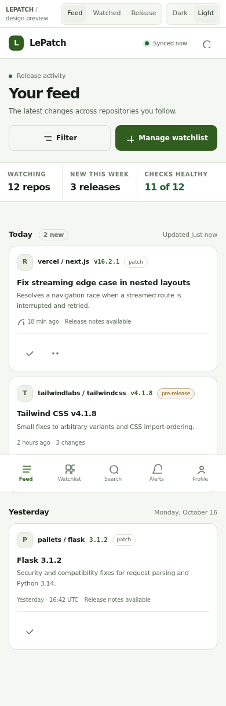
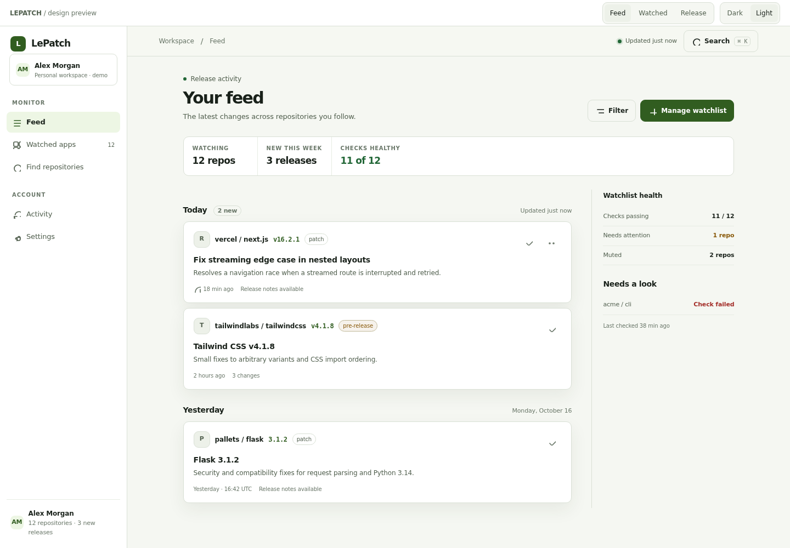

# LePatch

**Self-hosted GitHub release tracking and notifications.**

LePatch watches the repositories you care about, classifies what actually
shipped, and tells you where it matters — Discord, Telegram, or the dashboard.
It is a release radar, not a deployment tool: nothing is ever installed or
deployed on your behalf.

```
Repository → scheduled check → classified release → notification
```

## Features

- **Release monitoring** for any public or private repository you have access to
- **Release classification** into major / minor / patch / pre-release, with
  changelog parsing into sections
- **Notifications** to Discord webhooks and a shared Telegram bot
- **Per-user preferences**: enable/disable, quiet hours, severity filters,
  digest intervals, and issue-comment alerts
- **Issue tracking** with mention notifications
- **Repository browsing**: releases, commits, pull requests, issues, branches,
  workflow runs and file contents without leaving the app
- **Access control**: administrator, moderator, user and restricted roles, plus
  TOTP MFA, WebAuthn passkeys and GitHub OAuth
- **Audit log** for every administrative action
- **Database backups** on a schedule you control
- **Dark, light and system themes** — both designed from the same token set
- **Live updates** across open tabs and devices, with offline and reconnect states
- **Installable PWA** with a real app icon and offline shell

## Design preview

The clickable preview uses a seeded demo workspace so the screens can be reviewed
without access to a GitHub account or production database. Open
[`preview/design-direction.html`](preview/design-direction.html) to switch
between Feed, Watched apps, and Release detail, and between light and dark mode.

| Feed on phone | Feed on desktop |
| --- | --- |
|  |  |

The [design direction](docs/design-direction.md) includes the dark captures,
watched-app and release-detail screenshots, tokens, and responsive layout notes.

## Quick start

### Docker Compose (recommended)

```bash
git clone https://github.com/OWNER/lepatch.git
cd lepatch
cp .env.example .env
```

Edit `.env` — at minimum:

```env
APP_URL=https://lepatch.example.com
SESSION_SECRET=<64+ random characters>
ENCRYPTION_KEY=<32+ random characters>
DEFAULT_ADMIN_EMAIL=you@example.com
DEFAULT_ADMIN_PASSWORD=<a strong password>
GITHUB_TOKEN=ghp_...        # optional but strongly recommended
```

```bash
docker compose up -d
```

Open `APP_URL` and sign in with the admin credentials. The first-run wizard
walks through GitHub, Telegram and Discord setup.

Generate secrets with:

```bash
openssl rand -base64 48   # SESSION_SECRET
openssl rand -base64 32   # ENCRYPTION_KEY
```

### Local development

```bash
npm ci
npx prisma generate
docker compose up -d postgres redis
npx prisma migrate deploy
npm run dev            # app on http://localhost:3000
npm run worker         # in a second terminal
```

## Configuration

| Variable | Required | Purpose |
| --- | --- | --- |
| `APP_URL` | yes | Public URL. Anchors WebAuthn and OAuth redirects. |
| `SESSION_SECRET` | yes | Signs session JWTs and the OAuth state. |
| `ENCRYPTION_KEY` | yes | Encrypts secrets at rest. Changing it requires re-entering secrets. |
| `DATABASE_URL` | yes | PostgreSQL connection string. |
| `REDIS_URL` | yes | Redis for queues and rate limits. |
| `TRUST_PROXY` | no | Set `true` only behind a proxy you control. |
| `GITHUB_TOKEN` | no | Shared token for release checks. Without it GitHub rate-limits you to 60 requests/hour. |
| `WEB_AUTHN_EXTRA_ORIGINS` | no | Comma-separated extra origins allowed for passkeys (LAN aliases). |
| `DEFAULT_ADMIN_EMAIL` / `DEFAULT_ADMIN_PASSWORD` | no | Seeds the first administrator on an empty database only. |
| `DISCORD_WEBHOOK_URL`, `TELEGRAM_BOT_TOKEN`, `TELEGRAM_CHAT_ID` | no | Optional first-run channel defaults. |

See [`.env.example`](.env.example) for the full list.

## How it works

- The worker schedules release checks on a 60-second tick with per-app jitter so
  a large watch list does not stampede the GitHub API.
- Releases are compared by GitHub release ID and tag name — never by sorting
  version strings.
- Notification jobs retry with exponential backoff and carry stable job IDs, so
  a retry cannot deliver the same release twice.
- Secrets are encrypted with AES-256-GCM before they touch the database.

See [`AGENTS.md`](AGENTS.md) for the architecture and invariants, and
[`docs/design-system.md`](docs/design-system.md) for UI conventions. The
[`roadmap`](docs/roadmap.md) separates worker fixes from future product features.

## Development

```bash
npm run check       # lint + typecheck + tests + production build
npm test            # vitest
npm run dev         # dev server
npm run worker      # background worker
npm run deps:outdated
```

Database schema changes require a real migration:

```bash
npx prisma migrate dev --name describe_the_change   # development only
```

Never run `prisma db push` or `prisma migrate dev` against a production
database; ship the generated migration and apply it with
`prisma migrate deploy`.

## Tech stack

Next.js (App Router) · React · TypeScript · Tailwind CSS v4 · PostgreSQL ·
Prisma · Redis · BullMQ

## Contributing

See [`CONTRIBUTING.md`](CONTRIBUTING.md) and
[`CODE_OF_CONDUCT.md`](CODE_OF_CONDUCT.md). Security issues: see
[`SECURITY.md`](SECURITY.md).

## License

[MIT](LICENSE)
